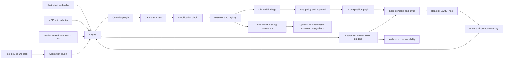

# Architecture and API

All TypeScript packages depend inward on contracts. Core uses Web-standard cancellation and cloning; it has no filesystem, renderer, provider or model dependencies. The host supplies the registry, platform name, caller authorization and services. IDSS stores intent, layout/navigation, transitions, workflows, required capabilities, timeout/approval settings, initial state, migration and provenance. The optional `ui.presentation` defines ordered rows of views at wide sizes and an ordered stack or navigable list of views at compact sizes. Each arrangement references every view once. Components can bind display and input to state and declare visible interaction modes. Mode visibility is presentation. Engine transitions and host policy enforce event authorization. A transition may require a text payload within declared length bounds before capture or execution.

| API | Contract |
| --- | --- |
| `Engine.preview(scope, text, context?, options?)` | Compile, migrate and validate a candidate; return affected sections, negotiated capability bindings and base revision. |
| `Engine.previewSpec(scope, candidate, options?)` | Validate an imported IDSS against the same rules. |
| `Engine.recommend(scope, context, options?)` | Ask the registered adaptation capability for an explanation and an intent. Compile a normal revision-bound preview or return null. |
| `Engine.apply(preview, options?)` | Accept only an unchanged preview from this engine. Recheck revision, bindings and policy; compose before committing. |
| `Engine.snapshot(scope)`, `Engine.view(scope)` | Read committed state or get the composed UI from the active specification. |
| `Engine.dispatch(scope, event, input, eventId, options?)` | Evaluate one transition, then run a deterministic topological task order; commit state and receipt together. |
| `Engine.rollback(scope, revision, options?)` | Restore a retained revision as a new one and preserve event receipts. Shared hosts can require an expected current revision. |
| `Engine.suggest(scope, requirement)` | Ask the evolution capability for a proposal. It cannot install anything. |
| `Registry.load(factory)`, `Registry.unload(id)` | Register a trusted factory/proxy; run lifecycle hooks. Registry changes are excluded during invocations. |
| `Registry.inspect(requirement, scope)`, `Registry.invoke(...)` | Resolve the highest allowed SemVer provider with satisfied dependencies; tie-break by plugin ID. |
| `Registry.available(scope)` | List a bounded set of authorized non-system capability versions for a host compiler. |
| `Registry(..., authorize, observer)` | Host-supplied grant function and structured lifecycle/error/timing observer. |

`IdasError.code` is one of `INVALID`, `MISSING`, `DENIED`, `CONFLICT`, `TIMEOUT`, `CANCELLED` or `PLUGIN`. Use the code to decide whether to refresh, request a grant, correct the specification, or retry. Keep the same event ID for an ambiguous retry. Once a write begins, it can still commit if the caller times out at the commit boundary; re-read before retrying.

The compiler receives the committed specification on every new turn. The offline compiler is deterministic and bounded. A host model provider can return a candidate IDSS via `modelCompiler`. Opting in to an availability callback adds a validated `ModelRequest` with JSON Schema and a scoped capability list. `diffSpecification` provides a bounded, deterministic list of JSON paths and before/after values for presentation. Its optional repair setting retries once with a bounded schema or semantic validation diagnostic. Capability and scope checks run after compilation and again on apply. The renderer and workflow runtime consume the committed specification without additional inference.

In the standard workflow plugin, task inputs may be literals, a single state value (`inputFrom`), or a JSON object assembled from named state keys (`inputBindings`). A task result saved to state is available to dependent tasks. A false condition skips the task and dependents. A workbench release expresses success and failure as separate branches on the test result. Adapter errors still propagate through the existing runtime.

The adaptation plugin receives a bounded device and task signal, the committed specification and current mode. It proposes an intent and a reason. Engine compiles that intent with the same compiler and validates the result against the same scope, grants and revision. The host decides when to ask for a suggestion and when to apply it.

An engine configured with `workspaceClaim: true` acquires the registered `idas.workspace-claim` capability before apply, dispatch or rollback, and releases it after the operation settles. The Node file plugin coordinates cooperating processes on the same local filesystem. Compare-and-swap still protects the final write. A crashed process leaves a fail-closed claim for manual recovery.

A missing installed capability returns `MissingCapabilityError` with a typed requirement. A host can call `Engine.suggest` with that requirement and optionally register the Node signed-catalog evolution plugin. The catalog proposes compatible descriptors. The host handles image provisioning, isolation tests, approval and registration.

IDSS/1 uses closed schemas plus semantic checks for references, unique transitions and acyclic task dependencies. `canonical` sorts object keys and preserves array order; it rejects non-JSON values, unsafe keys and excessively large/deep input. `migrate` upgrades the supported v0 presentation defaults. State schema changes are versioned separately; increment the version and declare explicit key renames, or use rollback to restore an older snapshot.

The new IDSS/1 fields are optional for existing specifications. Upgrade strict validators and renderers before sending specifications that use the new fields to older hosts.

Swift uses the IDSS/1 presentation projection and does not need a JavaScript engine. In an iOS Xcode project, add the Swift package at `packages/sdk-swift`, link the **IDAS** product, decode with `Specification.read`, and embed `Workspace(spec:data:onEvent:)`. For remote execution, the host authenticates each event, sends it to its IDAS service, and updates the Swift view from the returned committed snapshot.
