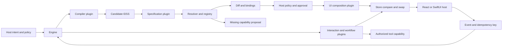

# Architecture and API

All TypeScript packages depend inward on contracts. Core uses Web-standard cancellation and cloning; it has no filesystem, renderer, provider or model dependencies. The host supplies the registry, platform name, caller authorization and services. IDSS stores intent, layout/navigation, transitions, workflows, required capabilities, timeout/approval settings, initial state, migration and provenance.

| API | Contract |
| --- | --- |
| `Engine.preview(scope, text, context?, options?)` | Compile, migrate and validate a candidate; return affected sections, negotiated capability bindings and base revision. |
| `Engine.previewSpec(scope, candidate, options?)` | Validate an imported IDSS against the same rules. |
| `Engine.apply(preview, options?)` | Accept only an unchanged preview from this engine. Recheck revision, bindings and policy; compose before committing. |
| `Engine.snapshot(scope)`, `Engine.view(scope)` | Read committed state or get the composed UI from the active specification. |
| `Engine.dispatch(scope, event, input, eventId, options?)` | Evaluate one transition, then run a deterministic topological task order; commit state and receipt together. |
| `Engine.rollback(scope, revision, options?)` | Validate and restore a retained revision as a new one. Current event receipts are preserved. |
| `Engine.suggest(scope, requirement)` | Ask the evolution capability for a proposal. It cannot install anything. |
| `Registry.load(factory)`, `Registry.unload(id)` | Register a trusted factory/proxy; run lifecycle hooks. Registry changes are excluded during invocations. |
| `Registry.inspect(requirement, scope)`, `Registry.invoke(...)` | Resolve the highest allowed SemVer provider with satisfied dependencies; tie-break by plugin ID. |
| `Registry(..., authorize, observer)` | Host-supplied grant function and structured lifecycle/error/timing observer. |

`IdasError.code` is one of `INVALID`, `MISSING`, `DENIED`, `CONFLICT`, `TIMEOUT`, `CANCELLED` or `PLUGIN`. Use the code to decide whether to refresh, request a grant, correct the specification, or retry. Keep the same event ID for an ambiguous retry. Once a write begins, it can still commit if the caller times out at the commit boundary; re-read before retrying.

IDSS/1 uses closed schemas plus semantic checks for references, unique transitions and acyclic task dependencies. `canonical` sorts object keys and preserves array order; it rejects non-JSON values, unsafe keys and excessively large/deep input. `migrate` upgrades the supported v0 presentation defaults. State schema changes are versioned separately; increment the version and declare explicit key renames, or use rollback to restore an older snapshot.

Swift uses the IDSS/1 presentation projection and does not need a JavaScript engine. In an iOS Xcode project, add the Swift package at `packages/sdk-swift`, link the **IDAS** product, decode with `Specification.read`, and embed `Workspace(spec:data:onEvent:)`. For remote execution, the host authenticates each event, sends it to its IDAS service, and updates the Swift view from the returned committed snapshot.
